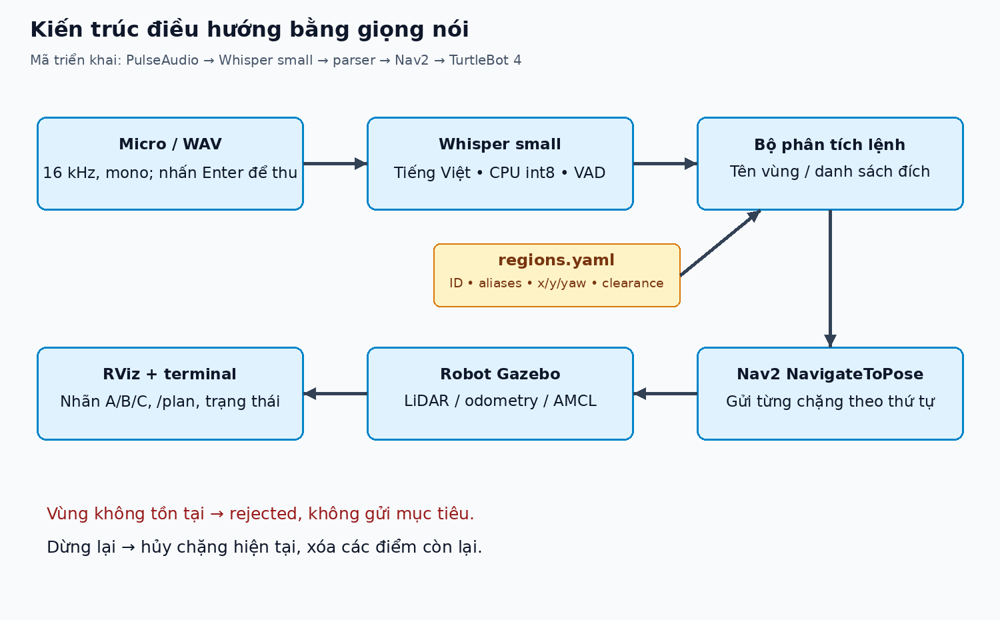
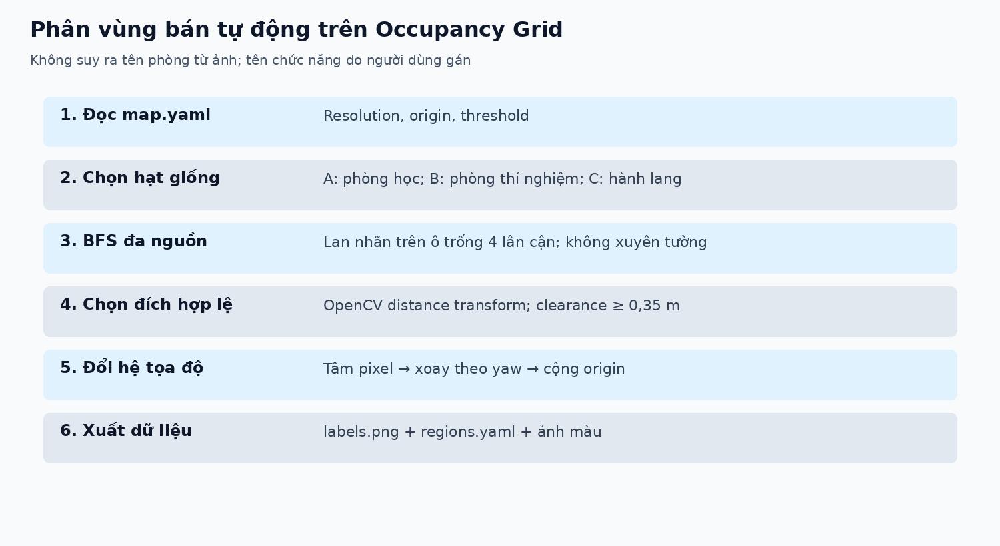
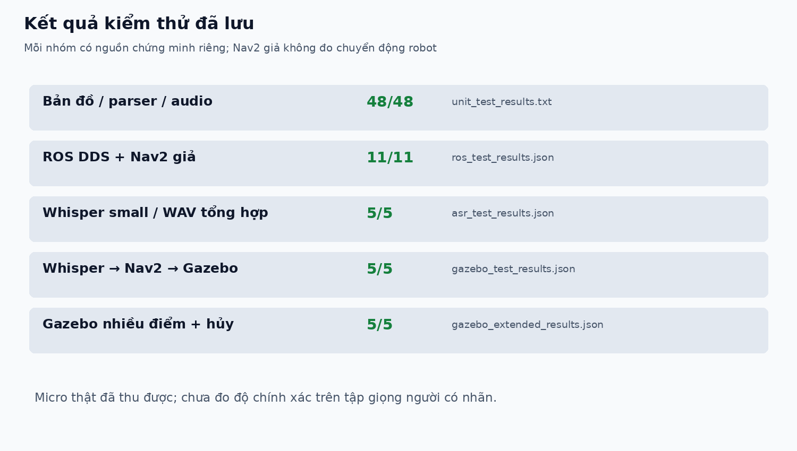

# Bài thực hành 7 — Phân vùng bản đồ và điều hướng TurtleBot 4 bằng giọng nói

**Ubuntu 22.04 · ROS 2 Humble · Ignition Gazebo Fortress · Nav2 · Whisper tiếng Việt**

Hệ thống phân vùng bản đồ 2D thành ba khu chức năng A/B/C, nhận câu lệnh giọng nói tiếng Việt và điều hướng robot đến đúng vùng. Hỗ trợ hành trình nhiều điểm, từ chối vùng không tồn tại và hủy hành trình đang chạy.

- Chủ repository: [langvanhuy1208](https://github.com/langvanhuy1208).
- Mã nguồn bài 7, hướng dẫn chạy và số liệu kiểm thử nằm trong repository này.
- [Ảnh dùng cho báo cáo](pictures/README.md) · [Video demo](videos/README.md) · [Kịch bản quay](docs/bai7/READY_TO_RECORD.md) · [Kết quả xác minh](docs/bai7/VALIDATION.md).
- Báo cáo do người dùng tự hoàn thiện; PDF/script mẫu cũ được giữ để tham khảo.


## 1. Chức năng

| Yêu cầu | Triển khai |
|---|---|
| Phân vùng Occupancy Grid | BFS đa nguồn trên ô trống 4 lân cận, khởi tạo bằng hạt giống thủ công |
| Nhãn có ý nghĩa | A = Phòng học, B = Phòng thí nghiệm, C = Hành lang |
| Đích điều hướng hợp lệ | Chọn tâm ô gần hạt giống, clearance tĩnh tối thiểu 0,35 m |
| Nhận giọng nói tiếng Việt | faster-whisper `small`, CPU int8, VAD; micro hoặc WAV |
| Điều hướng tránh vật cản | Action `nav2_msgs/action/NavigateToPose`, Nav2 lập đường và điều khiển |
| Nhiều điểm | Gửi chặng tiếp theo chỉ sau khi chặng trước thành công |
| Vùng không tồn tại | Từ chối toàn bộ lệnh, không bỏ qua điểm sai |
| Hủy / timeout / lệnh chồng | Hủy action, xóa phần còn lại; không chồng hành trình mới |
| Hiển thị | RViz: bản đồ, nhãn A/B/C, điểm đích, thứ tự waypoint, `/plan` |

## 2. Kiến trúc



```mermaid
flowchart LR
    A[Micro / WAV] --> B[Whisper tiếng Việt]
    B --> C[/voice_command]
    C --> D[Phân tích câu lệnh]
    E[regions.yaml] --> D
    D --> F[Hàng đợi A / B / C]
    F --> G[Nav2 NavigateToPose]
    G --> H[TurtleBot 4 / Gazebo]
    H --> I[LiDAR / odometry / AMCL]
    I --> G
    D --> J[RViz và trạng thái terminal]
    G --> J
```

`voice_navigation_node.py` dùng action client bất đồng bộ. Ví dụ “Đi từ A đến B” luôn đi A trước, kể cả robot đang ở nơi khác; chỉ khi A thành công mới gửi B. Nếu A thất bại hoặc người dùng hủy, B không được gửi.

## 3. Cấu trúc dự án

```text
.
├── scripts/
│   ├── semantic_map.py          # Tọa độ map, catalog, parser tiếng Việt
│   ├── segment_map.py           # Phân vùng và xuất YAML/ảnh
│   ├── map_from_world.py        # Bản đồ tham chiếu từ hình học SDF
│   ├── voice_audio.py           # Thu PulseAudio/PortAudio, 16 kHz mono
│   ├── voice_input.py           # Micro/WAV → Whisper → topic
│   ├── voice_navigation_node.py # Hàng đợi NavigateToPose, hủy và marker
│   ├── voice_demo_ready.py      # Kiểm tra map/TF/lifecycle, đặt pose spawn
│   └── run_bai7_live.sh         # Chạy toàn bộ để test/quay video
├── launch/voice_navigation.launch.py
├── config/
│   ├── regions_seed.yaml       # Hạt giống và tên gọi A/B/C
│   ├── nav_voice.rviz          # Giao diện RViz bài 7
│   └── cyclonedds_local.xml     # DDS loopback cho mô phỏng một máy
├── maps/
│   ├── phase2/                 # Map SLAM gốc được giữ nguyên
│   └── bai7/                   # Map demo, labels, vùng, ảnh phân vùng
├── pictures/                   # Ảnh/sơ đồ/biểu đồ/khung hình cho báo cáo
├── videos/                     # Video demo và mô tả nguồn âm thanh
├── tests/                      # Unit, ROS, Whisper, micro, Gazebo
└── docs/bai7/                  # Hướng dẫn sâu, JSON kết quả, tài liệu mẫu
```

Một số mã nguồn/launch của các bài trước được giữ để không phá workspace và phục vụ helper mô phỏng dùng chung. [Tài liệu bài 5/6 trước đây](docs/README_bai5_bai6.md) được lưu riêng.

## 4. Cài đặt trên máy mới

Cần ROS 2 Humble Desktop và bộ TurtleBot 4 Simulation đã cài theo môi trường học phần.

```bash
sudo apt update
sudo apt install \
  ros-humble-turtlebot4-simulator ros-humble-turtlebot4-navigation \
  ros-humble-nav2-bringup ros-humble-nav2-msgs ros-humble-nav2-simple-commander \
  ros-humble-visualization-msgs ros-humble-lifecycle-msgs \
  ros-humble-slam-toolbox ros-humble-cv-bridge \
  python3-colcon-common-extensions python3-venv python3-pip \
  python3-opencv python3-numpy python3-yaml python3-pil python3-pytest \
  pulseaudio-utils

git clone https://github.com/langvanhuy1208/TurtleBot-4_t7.git
cd TurtleBot-4_t7
source /opt/ros/humble/setup.bash
colcon build --packages-select tb4_simplesimu --symlink-install
source install/setup.bash

/usr/bin/python3 -m venv --system-site-packages .venv-voice
.venv-voice/bin/python -m pip install -r requirements-voice.txt
```

Venv phải có `--system-site-packages` để dùng `rclpy`, OpenCV và các extension ROS từ apt. Giới hạn NumPy `<2` được giữ trong requirements cho tương thích Humble. Không cài pip vào Python hệ thống. Whisper chạy cục bộ, không cần API key; cần mạng để tải mô hình lần đầu. Cache mô hình, venv, build/install/log không được đưa lên GitHub.

Nếu chọn backend `sounddevice` thay vì PulseAudio: cài thêm `sudo apt install libportaudio2`. Máy đã thử dùng PulseAudio qua `parec`, không cần PortAudio.

## 5. Chạy nhanh — một lệnh

Tại thư mục gốc dự án:

```bash
bash scripts/run_bai7_live.sh
```

Script thực hiện:

1. Kiểm tra thư viện và micro mặc định.
2. Mở Gazebo headless, robot, Nav2 và RViz.
3. Đối chiếu nội dung `/map` với catalog vùng.
4. Đặt pose spawn `(2, 0, π)` cho **phiên mô phỏng mới**.
5. Chờ odometry, TF/AMCL và lifecycle Nav2 ACTIVE.
6. Hiện **SẴN SÀNG QUAY VIDEO**, sau đó chờ nhấn Enter để thu từng câu.

Nhấn Enter, nói trong 6 giây rồi chờ nhận dạng. Terminal tiếp tục hiện `accepted`, `navigating`, `arrived`, `completed` trong lúc robot chạy. Chờ `completed` trước lệnh mới. **Ctrl+C** dừng cả đầu vào và mô phỏng.

Lệnh này dành cho một phiên mới, không khởi động hai bản cùng lúc. Script dùng ROS domain 87 và Gazebo partition riêng; nếu đổi `ROS_DOMAIN_ID`, mọi terminal liên quan phải dùng cùng giá trị. Log và WAV micro lưu ở `log/bai7_live/`; dữ liệu này không tự đưa lên public.

Các tùy chọn:

```bash
# Thời gian thu mỗi câu 8 giây
bash scripts/run_bai7_live.sh --seconds 8

# Chọn nguồn PulseAudio khác
pactl list short sources
bash scripts/run_bai7_live.sh --pulse-source TEN_SOURCE

# Máy yếu: tắt RViz trong phiên chạy
BAI7_RVIZ=false bash scripts/run_bai7_live.sh

# Chỉ định mô hình đã tải cục bộ
BAI7_MODEL=/duong/dan/model-small bash scripts/run_bai7_live.sh
```

Không chọn nguồn kết thúc bằng `.monitor`: đó là âm thanh loa, không phải micro.

## 6. Các câu lệnh

| Câu nói | Hành vi |
|---|---|
| “Đi đến khu vực A.” / “Đi đến khu A.” | Đến A: Phòng học |
| “Đi đến khu vực B.” / “Đi đến khu B.” | Đến B: Phòng thí nghiệm |
| “Đi đến khu vực C.” / “Đi đến khu C.” | Đến C: Hành lang |
| “Đi đến phòng học.” | Đến A |
| “Đi đến phòng thí nghiệm.” | Đến B |
| “Đi đến hành lang.” | Đến C |
| “Di chuyển từ khu vực A đến khu vực B.” | A → B |
| “Đi từ phòng A qua hành lang rồi đến phòng B.” | A → C → B |
| “Đi đến khu vực Z.” | `rejected`, không gửi goal |
| “Dừng lại.” / “Hủy điều hướng.” | Hủy chặng hiện tại và xóa hàng đợi |

Parser chuẩn hóa chữ hoa/thường, dấu câu và dấu tiếng Việt, rồi khớp **alias đầy đủ**. Tên gọi “khu A/B/C” và các cách đọc bê/xê được lưu trong YAML. Alias “hành lan” được thêm sau khi quan sát lỗi phiên âm; không dùng fuzzy matching không giới hạn. Câu phiên âm sai như “Đi và phụ A” vẫn bị từ chối để tránh đi nhầm.

Thử không dùng micro (terminal cùng ROS domain với mô phỏng):

```bash
export ROS_DOMAIN_ID=87
export RMW_IMPLEMENTATION=rmw_cyclonedds_cpp
export CYCLONEDDS_URI="file://$PWD/config/cyclonedds_local.xml"
source /opt/ros/humble/setup.bash
source install/setup.bash

.venv-voice/bin/python scripts/voice_input.py --text 'Đi đến khu A'
.venv-voice/bin/python scripts/voice_input.py --wav docs/bai7/audio/01.wav --model small
ros2 topic echo /voice_nav/status
```

`--text` chỉ xác minh parsing và Nav2, không phải bằng chứng nhận dạng giọng nói. Nếu vừa sửa YAML/alias, khởi động lại node điều hướng hoặc chạy lại script để catalog mới được nạp.

## 7. Phân vùng bản đồ và hệ tọa độ



Phân vùng bán tự động bằng BFS đa nguồn trên đồ thị ô trống 4 lân cận. Hạt giống và tên vùng do người dùng chọn; nhãn lan theo đường đi trên bản đồ, không xuyên tường. Đây là khu chức năng gán nhãn, không phải mô hình tự nhận biết phòng học từ ảnh.

Điểm đích gần hạt giống nhất phải nằm trong vùng và có clearance tĩnh ít nhất 0,35 m, tính bằng OpenCV distance transform. Không dùng tâm hình học nếu tâm nằm trong tường.

| Vùng | Hạt giống map (m) | Tên |
|---|---|---|
| A | (-2, 0) | Phòng học |
| B | (2, 3) | Phòng thí nghiệm |
| C | (2, -3) | Hành lang |

Đích thực dùng tâm ô và lưu chính xác trong `maps/bai7/regions.yaml`. Với pixel `(u, v)`, chiều cao `H`, resolution `r`:

```text
x_local = (u + 0.5) * r
y_local = (H - v - 0.5) * r
[x_map, y_map] = rotation(origin_yaw) * [x_local, y_local] + origin_xy
```

Xuất lại bản đồ/phân vùng:

```bash
python3 scripts/map_from_world.py --world worlds/maze_fast.sdf --output maps/bai7
python3 scripts/segment_map.py --map maps/bai7/map.yaml \
  --seeds config/regions_seed.yaml --output maps/bai7
```

**Nguồn bản đồ:** `maps/phase2` là bản SLAM gốc được giữ nguyên. Demo dùng map tham chiếu raster hóa collision box của `maze_fast.sdf`, có hệ `map` trùng world Gazebo; đây **không phải bản SLAM mới**. Bản phân vùng SLAM cũ nằm tại `maps/bai7/phase2-segmentation/`.

Pixel 205 được giữ là chưa biết với `free_thresh: 0.196`. Ô vật cản/chưa biết và phần rời không tới từ hạt giống giữ nhãn 0. Ảnh `labels.png` là uint16; ảnh màu chỉ trình bày, không thay PGM của Nav2. Catalog kiểm tra hash map, ô trống, clearance và membership vùng khi khởi động.

Dùng map khác: chọn lại hạt giống trong đúng hệ `map`, chạy segmentation, khởi động Nav2 với chính map đó và truyền `regions_file` tương ứng. Không dùng pose SLAM cũ làm pose world nếu chưa xác định transform ban đầu.

## 8. Topic, action và RViz

| Giao diện | Kiểu | Nội dung |
|---|---|---|
| `/voice_command` | `std_msgs/msg/String` | Câu lệnh sau ASR hoặc test |
| `/voice_nav/transcript` | `std_msgs/msg/String` | Văn bản nhận dạng |
| `/voice_nav/status` | `std_msgs/msg/String` JSON | Trạng thái và lỗi |
| `/semantic_regions` | `visualization_msgs/msg/MarkerArray` | Điểm đích và nhãn A/B/C |
| `/voice_nav/route` | `visualization_msgs/msg/Marker` | Thứ tự waypoint |
| `/navigate_to_pose` | `nav2_msgs/action/NavigateToPose` | Goal từng chặng |
| `/plan` | `nav_msgs/msg/Path` | Đường Nav2 thực sự lập |
| `/amcl_pose` | `geometry_msgs/msg/PoseWithCovarianceStamped` | Vị trí ước lượng robot |

RViz mặc định hiển thị bản đồ, robot, LiDAR, nhãn vùng và kế hoạch. Đường nối waypoint chỉ biểu diễn **thứ tự**, không phải quỹ đạo tránh tường; xem `/plan` để biết đường đi thực. Nhãn dùng A/B/C để đọc rõ cạnh tường; tên tiếng Việt đầy đủ thể hiện trong cấu hình và terminal.

Khi mới mở mà `Feedback: unknown`, Navigation/Localization đã active và chưa gửi goal thì đây là trạng thái chờ bình thường.

## 9. Kiểm thử và kết quả

```bash
PYTEST_DISABLE_PLUGIN_AUTOLOAD=1 python3 -m pytest -q \
  tests/test_semantic_navigation.py tests/test_voice_audio.py

# Mỗi bộ ROS thử riêng trên domain không trùng phiên đang chạy
ROS_DOMAIN_ID=77 python3 tests/ros_voice_smoke.py
ROS_DOMAIN_ID=77 python3 tests/ros_scan_smoke.py

# Đọc WAV bằng Whisper thật
.venv-voice/bin/python tests/whisper_voice_smoke.py --model small

# Với một mô phỏng mới, robot còn ở pose spawn
python3 tests/gazebo_voice_extended.py
```



- 48 unit test: map, parser, alias “khu A/B/C”, vùng sai, giới hạn đầu vào âm thanh.
- Bộ ROS dùng DDS/action thực và **Nav2 giả**; số ca hiện hành nằm trong `ros_test_results.json`.
- Whisper small trên WAV tổng hợp: 5/5 mẫu xử lý đúng, gồm từ chối Z.
- Pipeline WAV → Whisper → Nav2/Gazebo cơ bản: 5/5 kịch bản đạt.
- Gazebo mở rộng: hoàn thành A → C → B, từ chối điểm trung gian sai, từ chối lệnh chồng, dừng khi hủy và chạy lại sau hủy.
- Chặng A → C → B đo bằng AMCL dài khoảng 18,688 m; sai số đích cuối 0,216 m, clearance nhỏ nhất 0,400 m. Sau hủy, odometry về 0 m/s và 0 rad/s.
- Micro thật được kiểm tra thu 16 kHz mono qua PulseAudio và xử lý qua CLI/Whisper. Chưa đo độ chính xác trên tập câu giọng người có nhãn trong tiếng ồn.


Các tệp JSON là bằng chứng đo của từng bộ, không gộp Nav2 giả thành bằng chứng robot di chuyển. Test Gazebo mở rộng dùng lệnh văn bản; test pipeline cơ bản dùng WAV tổng hợp. Các lần thử chưa đạt trước khi chỉnh cấu hình được giữ riêng để đối chiếu.

## 10. Ảnh và video để làm báo cáo

- [Thư mục `pictures/`](pictures/README.md): bản đồ gốc, bản đồ tham chiếu, phân vùng A/B/C, kiến trúc, quy trình, biểu đồ và khung hình demo.
- [Thư mục `videos/`](videos/README.md): video có track giọng tổng hợp và bản gốc chưa ghép tiếng.
- [Video có âm thanh](videos/01_demo_giong_tong_hop_Whisper_Nav2.mp4).
- [Khung hình từ chối Z](pictures/10_demo_tu_choi_vung_Z.png).
- [Ảnh RViz thực trong phiên kiểm thử](pictures/12_RViz_phien_kiem_thu.png).

Video hiện có ghi dữ liệu trực tiếp từ Gazebo/AMCL/Nav2; đầu vào là WAV tổng hợp, không phải bản quay người dùng nói qua micro. Track ghép là phát lại WAV trước thời điểm chấp nhận lệnh. Khi quay giọng thật, ghi màn hình kèm micro và lưu bản mới vào `videos/`.

Gợi ý báo cáo 1–2 trang: dùng ảnh phân vùng 03, sơ đồ 05, biểu đồ 07 và ảnh xử lý Z 10; mô tả nguồn bản đồ, BFS, đổi tọa độ, Whisper và kết quả đúng phạm vi đo. Người dùng tự làm báo cáo theo yêu cầu học phần.

## 11. Xử lý lỗi thường gặp

| Hiện tượng | Kiểm tra / cách xử lý |
|---|---|
| Robot không chạy, `rejected` | Đọc transcript; tên vùng phải thuộc aliases. “khu A/B/C” đã được hỗ trợ; restart sau khi sửa YAML. |
| Whisper nghe sai câu | Nói rõ sau Enter, kiểm tra đúng micro, tăng `--seconds`, giảm tiếng ồn. Không sửa parser để chấp nhận câu vô nghĩa. |
| `Âm thanh quá nhỏ` | Kiểm tra mute và input volume trong Ubuntu Sound Settings. |
| `PortAudio library not found` | Dùng backend mặc định PulseAudio, hoặc cài `libportaudio2` nếu muốn sounddevice. |
| Không thấy node điều hướng | Cùng `ROS_DOMAIN_ID`, RMW, cấu hình DDS và đã source ROS/install. |
| Nav2 chưa ACTIVE / thiếu TF | Đợi script kiểm tra; nếu timeout xem `log/bai7_live/simulation.log`. |
| Đang chạy bị từ chối lệnh mới | Nói “Dừng lại”, chờ `cancelled`, sau đó gửi lệnh mới. |
| Điểm đích bị vật cản mới chặn | Nav2 có thể phục hồi hoặc báo thất bại; điểm hợp lệ trên map tĩnh không đảm bảo luôn tiếp cận được. |
| Sửa/tạo thêm tệp nhưng install chưa có | Build lại bằng colcon, rồi source `install/setup.bash`. |

## 12. Tài liệu và giấy phép

- [Hướng dẫn triển khai sâu](docs/bai7/README.md).
- [Nav2 Humble NavigateToPose](https://api.nav2.org/actions/humble/navigatetopose.html).
- [faster-whisper](https://github.com/SYSTRAN/faster-whisper).
- [LaserScan timestamp — ROS common_interfaces](https://github.com/ros2/common_interfaces/blob/rolling/sensor_msgs/msg/LaserScan.msg).
- Giấy phép: [Apache License 2.0](LICENSE). Các phần mã phụ thuộc/có bản quyền upstream giữ thông báo giấy phép tương ứng.
